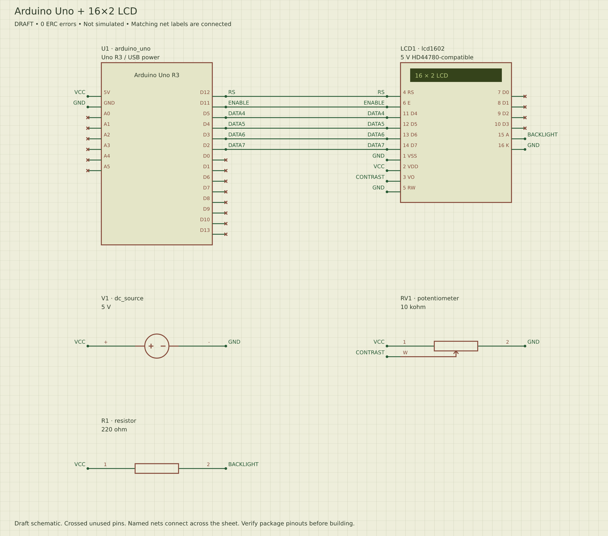
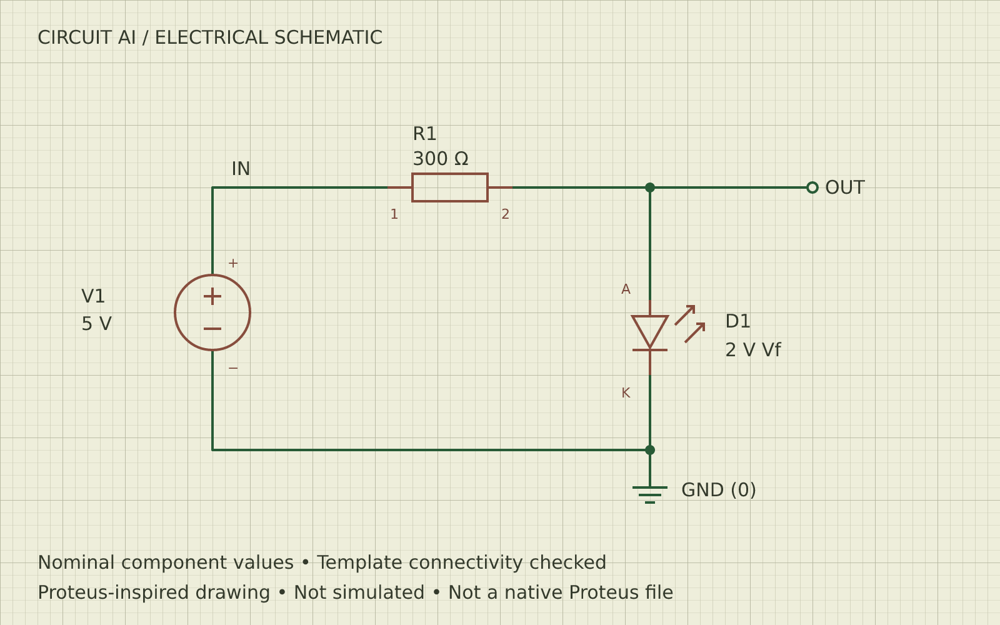

# Circuit AI — editable multi-component studio (v0.3)

Prompt → reviewable netlist → electrical-rule checks → editable schematic → SVG/PNG downloads.

Open `/studio` for the new editor. The original three-template API at `/v1/generate` and the simple page at `/` remain available.

## Try it yourself

1. Open `/studio`, choose **Arduino Uno + 16×2 LCD**, and press **Load example**.
2. Or enter `Arduino Uno with a 16x2 LCD` and press **Draft new circuit** in built-in mode.
3. Edit values and connections in the tables, then press **Apply edits & check**. Drag symbols to change their placement.
4. Download SVG, PNG, or editable JSON. Import the JSON later to continue editing. The latest applied design is also saved in this browser; API keys are not saved.
5. Press **Run example tests** for three server-backed software checks.

Free-form prose and conversational revisions require a reachable Ollama service configured with `OLLAMA_URL` and `OLLAMA_MODEL`. Vercel cannot reach Ollama on your phone/laptop through `localhost`. Use a server-reachable service. AI output is checked against the catalog and netlist schema, but prompt interpretation must still be reviewed. Missing or unknown parts trigger clarification. No live model was configured during this implementation; model-boundary tests use mocks.

## What this release supports

- 13 built-in logical part definitions including Arduino Uno R3, HD44780-compatible parallel 16×2 LCD, resistors, capacitors, LEDs, diodes, inductors, potentiometers, switches, DC sources, generic NPN/NMOS devices, and connectors.
- User-defined components through `custom_parts`, with exact pin names and pin roles. These are rendered as generic symbols and remain unverified.
- Up to 200 components, 1,000 nets, 100 custom definitions, and 64 pins per custom definition **per design**. This is not a catalog of thousands of verified devices.
- Multi-drop named nets, real component symbols, and direct wires between unobstructed facing pins. Identical green net labels connect across the drawing; this is not a full obstacle-avoiding wire router.
- Schema validation: unknown references/pins, duplicate references/nets, conflicting pin assignments, malformed data, resource limits.
- Limited electrical-rule checks: required pins, shorted two-terminal devices, direct power-to-ground shorts, direct supply mismatches, fixed push-pull output conflicts, missing values, disconnected groups. Generic bidirectional GPIO configuration and indirect supply paths are not fully analyzed.
- Edits are rendered even when ERC errors exist, with an explicit draft/error status. Structural errors return HTTP 422.

No SPICE/Proteus simulation, native Proteus file export, universal controller synthesis, automatic firmware generation, or hardware correctness guarantee is provided. The 1,000-case test exercises generated software variations; it is not 1,000 electrically validated circuit families.

## New API

| Endpoint | Purpose |
| --- | --- |
| `GET /v2/catalog` | Part definitions, pins, limits, AI configuration status |
| `GET /v2/examples` | Controller/LCD, LED bank, RC ladder editable designs |
| `POST /v2/draft` | `{prompt, parser, previous_design?}` → checked draft and SVG |
| `POST /v2/render` | `{design, image_format: "svg" or "png"}` → redraw after edits |
| `POST /v2/validate` | Design object → electrical-rule diagnostics |

`CIRCUIT_API_KEY`, when configured, protects all generation/render/validation endpoints via the `X-API-Key` header. PNG output is capped at 4,096 pixels on its longest side. JSON is the source of truth for editing; an exported PNG cannot be re-imported as a circuit.

### Custom component/net input (works without an AI provider)

```text
component V1 dc_source 5 V
component R1 resistor 330 ohm
component D1 led red
net VCC V1.+ R1.1
net LED R1.2 D1.A
net GND D1.K V1.-
```

Use exactly `component REF PART VALUE` and `net NAME REF.PIN REF.PIN ...`. Extra prose is rejected rather than silently ignored. Supported example prompts are `Arduino Uno with a 16x2 LCD`, `4-channel LED bank` (1–64 channels), and `Two-stage RC filter`.

For a part outside the catalog, import/edit JSON with a `custom_parts` entry:

```json
{"custom_parts":{"my_sensor":{"name":"User-specified sensor","pins":{"VCC":"power_in","GND":"ground","OUT":"output"},"required":["VCC","GND","OUT"]}}}
```

This fragment belongs inside a full design with `components` and `nets`. Supply manufacturer pinouts yourself; the engine does not invent them.

## Controller/LCD reference

The Uno-to-LCD example follows [Arduino's LiquidCrystal documentation](https://docs.arduino.cc/learn/electronics/lcd-displays/): RS=D12, E=D11, LCD D4–D7=Uno D5–D2, RW grounded, contrast potentiometer. LCD pin numbers are for the common 16-pin parallel interface; verify your exact module. V1 represents the Uno USB-derived 5 V rail, not a second supply to connect simultaneously.



## Developer tests

```sh
pip install -r requirements-dev.txt
python -m pytest -q
uvicorn app.main:app --host 127.0.0.1 --port 8765
```

Open http://127.0.0.1:8765/studio. Optional browser test in a second terminal (requires Playwright and Chromium):

```sh
pip install playwright
python scripts/browser_test.py
```

Set `BROWSER_EXECUTABLE` for your Chromium path and `STUDIO_TEST_URL` to test another server. The browser test covers value edits, drag, downloads, example checks, JSON import, and mobile overflow. GitHub Actions runs the Python suite on pushes/PRs. See `TESTING.md` for the validation record and remaining limits.

## Original simple-circuit workflow

## Diagram style

The default `diagram_style: "proteus"` uses a light drafting grid, green orthogonal wires, junction dots, brown component symbols, IEC rectangular resistors, engineering-unit values, and pin labels. Choose `"classic"` for the original white schematic. Both styles use the same checked graph and calculations.

The browser offers SVG, PNG, circuit JSON, and (when available) SPICE downloads. Proteus-inspired describes the appearance only: no `.pdsprj` or `.dsn` export and no Proteus simulation are implemented. For controller/LCD drafts use the v2 studio described above.



## What works

- Three constrained circuit families: DC LED with series resistor, unloaded resistive voltage divider, passive first-order RC low-pass.
- Strict built-in prompt syntax, with no model or key needed for local use.
- Optional Ollama natural-language intent extraction with JSON-schema output validation. The model can only select supported circuits and parameters; it cannot execute code or generate arbitrary SVG.
- Graph checks for missing ground, dangling nets, shorted pins, duplicate references and disconnected circuits.
- Deterministic SVG and PNG from the same graph used for the bill of materials and SPICE export.
- Nominal analytical calculations; separate explicit fields for what has and has not been validated.
- Browser form at `/`, interactive API docs at `/docs`, OpenAPI at `/openapi.json`.
- Optional API-key protection for generation. No keys stored by the browser.

## Run locally

Use Python 3.12. PNG conversion uses the self-contained resvg renderer. Vercel configuration is included.

```sh
python -m venv .venv
. .venv/bin/activate
pip install -r requirements-dev.txt
python -m pytest -q
uvicorn app.main:app --host 127.0.0.1 --port 8000
```

Open http://127.0.0.1:8000 on the same computer. Vercel production project: circuit-api (AnEmpire team). Public URL: https://circuit-api-two.vercel.app . Source repository: https://github.com/sumiEmpire001/Circuit_AI . Deployment connection/status must be checked separately.

Or build and run the provided container (container build has not been tested here):

```sh
docker build -t circuit-api .
docker run --rm -p 127.0.0.1:8000:8000 circuit-api
```

## Make an API request

```sh
curl http://127.0.0.1:8000/v1/generate \
  -H 'Content-Type: application/json' \
  -d '{"prompt":"led; supply_v=5; led_vf=2; led_current_ma=10","parser":"builtin","image_format":"svg"}'
```

Response includes `image.svg`, `components`, `intent`, `calculations`, `validation`, `assumptions`, and `spice_netlist`. For PNG, set `image_format` to `png`; decode `image.base64` to image bytes. These are JSON responses, not direct image downloads. The browser form provides download buttons.

Built-in examples (numeric values must use SI units, except LED current in mA):

```text
led; supply_v=5; led_vf=2; led_current_ma=10
voltage divider; supply_v=5; r1_ohm=10000; r2_ohm=10000
rc lowpass; supply_v=5; r1_ohm=1000; capacitance_f=1e-7
```

No silent parameter defaults: the required supply, resistance/capacitance or LED specifications must be present. The LED series resistor may be omitted: it is calculated and rounded up to E24. If provided, it must not exceed the requested nominal LED current. Supply range is 0–24 V exclusive of zero, with further limits in the OpenAPI schema. Extra and duplicate parameters are rejected.

## Enable natural-language interpretation

Run an Ollama server with a model you have installed and reviewed for your machine and use case. Then export server-side variables before starting the API:

```sh
export OLLAMA_URL=http://127.0.0.1:11434
export OLLAMA_MODEL=your-installed-model-name
export CIRCUIT_API_KEY=your-long-random-key
```

Use `parser: "ollama"` and a prompt such as: “Draw an unloaded voltage divider from 5 V using R1=10 kohm and R2=10 kohm.” When configured, send the API key as `X-API-Key`.

`.env.example` is a reference; the application does not auto-load it. In Docker, localhost refers to the container, so configure a reachable model server address. The Ollama client does not use environment HTTP proxies. Model URLs are server configuration, not user-controlled request fields.

**Live AI inference was not tested:** no running model was supplied. Success, refusal, invalid JSON-schema output and provider failure were tested with mocked responses. Model interpretation always carries `prompt_interpretation_requires_review=true`; schema checks cannot prove that the model preserved every natural-language requirement.

## Accuracy and present limits

- The renderer uses Schemdraw symbols. These are electrical schematics, not PCB layouts, wiring harnesses, breadboard views or photographs.
- `template_checks_passed` means graph checks and the supported template calculations passed. It does not mean simulated, physically tested or certified.
- LED calculation assumes a constant forward voltage supplied by the user. It omits LED tolerance, thermal variation and resistor tolerance. No invented diode SPICE model is exported.
- Divider output is unloaded; actual attached loads change the voltage.
- RC cutoff assumes an ideal source and unloaded output. Its reported peak resistor power assumes an initially discharged capacitor and a DC step.
- Suggested resistor power is a simple 2x nominal/peak margin with a 0.25 W floor; select a real rated part against its datasheet. It is not a complete thermal design.
- SPICE text for divider and RC is exported but **not executed**. LED SPICE output is null until a sourced device model is available.
- UI was delivered and the HTML route tested; no browser automation suite was run.
- Public prototype: production hardening still needs request-size limits, rate limits, usage quotas, HTTPS and operational monitoring. AI/render work currently runs in the request path and needs bounded workers for scale.

## Verification

25 automated cases passed in the development environment. These cover known analytical outputs, PNG signature, SVG generation, API auth, bad parameters, rejected graph defects, model boundary behavior, and API contract availability. All three generated examples were reviewed as images. Two dependency deprecation warnings were emitted; no failing tests remained.

Run `python -m examples.generate_examples` to regenerate the three example SVG/PNG/JSON sets and the OpenAPI snapshot. Existing sample files can be opened without running the server.

## Next milestones toward your own model

1. **Simulation gate:** run ngspice in a resource-limited worker; compare voltage/current/frequency response to requested targets. Include tolerances and validate model provenance.
2. **Expand circuit families:** verified transistor switches, op-amp circuits, 555 timers, regulators and microcontroller interfaces. Require datasheet pin maps and power constraints for every new part.
3. **Curated dataset:** collect licensed schematics, editable netlists, component metadata, prompts, expected measurements, simulation models and expert reviews. Images alone are insufficient labels for connectivity.
4. **Model training:** fine-tune a suitable text-to-structured-circuit model on reviewed examples, including unsupported requests and clarification questions. Keep topology families separated across training/test splits to prevent leakage. Training has not begun in this prototype.
5. **Acceptance benchmarks:** measure prompt constraint satisfaction, correct pin/net assignments, simulation success, electrical target errors, unreadable labels and unsupported-request rejection. Do not use image similarity as the only accuracy score.
6. **Production API:** add asynchronous jobs, authenticated accounts, quotas, persistent versioned designs, audit history, and hosted inference. Publish only after full end-to-end checks.

Maintain reviewer identity, license/source, component/model revision and test results with each dataset record. No training corpus or pretrained weights are included here.

## Primary documentation

- https://schemdraw.readthedocs.io/en/stable/usage/start.html
- https://fastapi.tiangolo.com/tutorial/testing/
- https://ollama.com/blog/structured-outputs
